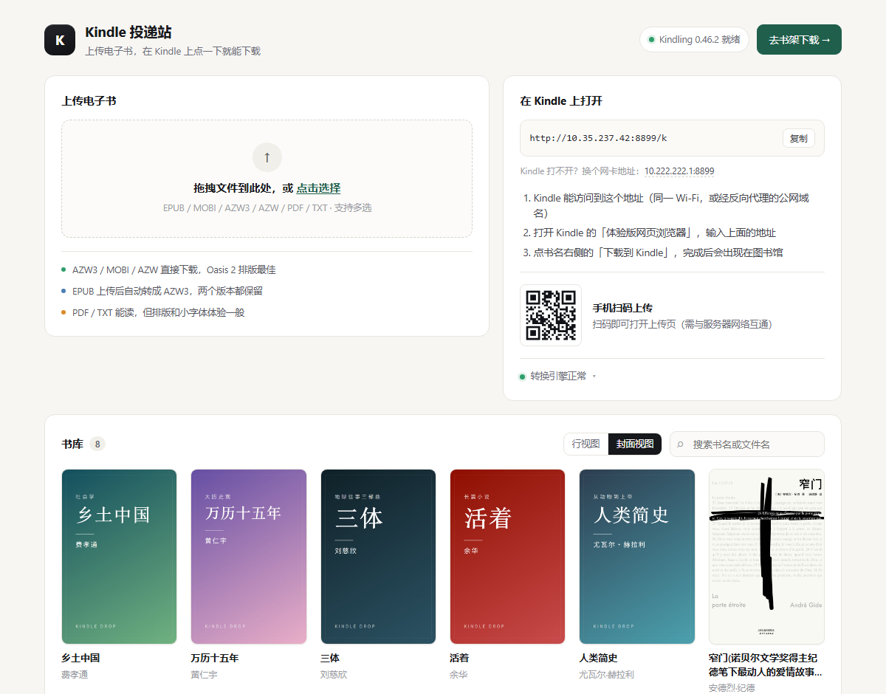
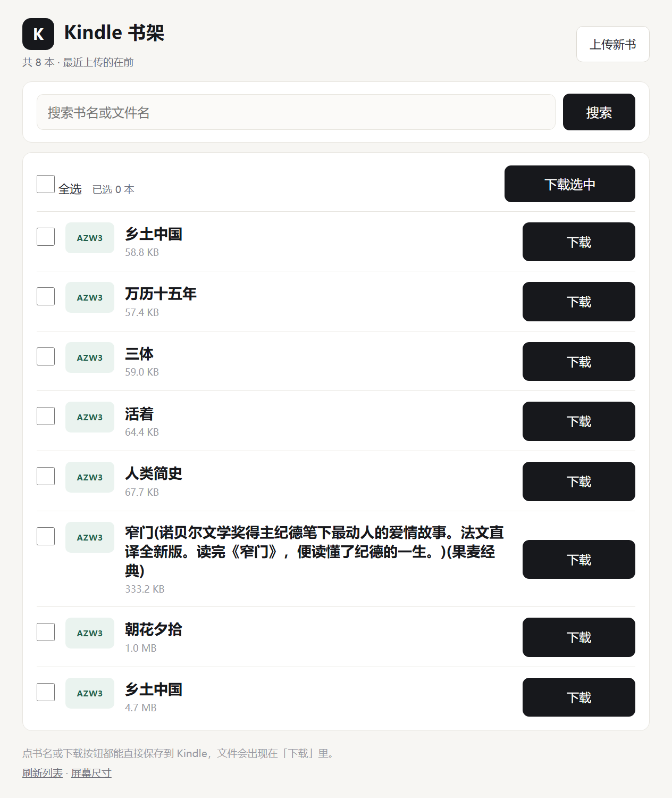

# Kindle Drop · 墨水屏传书站

**手机/电脑上传 → Kindle 打开网页点一下 → 书就存到本地。**

自托管的电子书投递站，一个 Docker 容器跑起来。不上传云端、不绑定账号、不需要数据线。

[English](#english) · [部署到 NAS](部署到NAS.md)




## 为什么做这个

- 亚马逊中国区 Kindle 书店 2023 年已关停，中国区 Send to Kindle 邮件推送也已停止服务，Kindle 用户只能靠 USB 或第三方工具传书
- 邮件推送有 25MB 上限，EPUB 还经常被转坏格式
- 用 USB 传书必须开电脑、连线、找文件夹
- 网盘链接在 Kindle 浏览器里几乎点不动

所以做一个「传进来 → 打开就下」的中转站：**上传端给手机/电脑用，接收端专门给墨水屏的破浏览器用。**

## 功能

| | |
|---|---|
| **上传端 `/`** | 拖拽 / 多选上传、单文件进度条、书库管理、二维码扫码在手机上传 |
| **接收端 `/k`** | 零 JS 服务端渲染，大字号大按钮，按书名搜索，勾选多本批量下载 |
| **格式转换** | EPUB → AZW3 自动转换（Kindling 引擎，17MB 单文件，不需要装 570MB 的 Calibre） |
| **去重** | 按文件内容 sha256 判重，同一本书重复上传自动跳过 |
| **排序** | 两边列表都按上传时间倒序 |
| **体积** | 镜像约 250MB，1GB 内存、2 核 CPU 足够，J1900 级别的 NAS 也能跑 |

## 快速开始

### Docker（推荐）

```bash
git clone https://github.com/<your-name>/kindle-drop.git
cd kindle-drop
docker compose up -d --build
```

首次构建 3–5 分钟（要拉基础镜像 + 下载 Kindling 转换引擎）。完成后访问 `http://你的IP:8899`。

不想用 compose 也行：

```bash
docker build -t kindle-drop .
docker run -d --name kindle-drop --restart unless-stopped \
  -p 8899:8899 -e TZ=Asia/Shanghai \
  -v "$PWD/data:/app/data" \
  kindle-drop
```

### 直接跑（需要 Node.js 22+）

```bash
npm install
npm start
```

转换引擎二选一：把对应平台的 kindling 放进 `tools/`（[releases](https://github.com/ciscoriordan/kindling/releases) 提供 linux / mac / windows 三个版本），或装好 Calibre（启动时自动查找）。

## 配置

改 `data/config.json`，或者用环境变量覆盖（容器推荐后者）：

| 变量 | 默认 | 说明 |
|---|---|---|
| `PORT` | `8899` | 服务端口 |
| `PUBLIC_URL` | 空 | 对外访问地址。**通常不用填**，页面会跟着你访问的地址走 |
| `AUTO_CONVERT` | `true` | 上传 EPUB 后自动转 AZW3 |
| `KEEP_ORIGINAL` | `true` | 转换后保留原始 EPUB |
| `KINDLING_BIN` | 自动查找 | Kindling 可执行文件路径 |
| `CALIBRE_PATH` | 自动查找 | `ebook-convert` 路径（备选引擎） |

其他项（`maxFileSizeMB` 等）在 `data/config.json` 里改，改完重启生效。

数据全部在 `data/` 一个目录里：`library.json` 是索引，`files/` 是文件。备份它就等于备份整个书架。

## 使用流程

1. 手机/电脑打开 `http://NAS的IP:8899`，拖书进去（或扫页面上的二维码）
2. EPUB 会在几秒~几十秒内转成 AZW3
3. Kindle 用「体验版网页浏览器」打开 `http://NAS的IP:8899/k`
4. 点「下载到 Kindle」，文件会出现在 Kindle 的**「下载」**分类里

## ⚠️ 安全提醒

**这个服务没有登录、没有鉴权，同一个网络里的人都能看到全部书。**

- 只适合家庭局域网、内网使用
- 不要直接做端口映射到公网
- 确实需要外网访问，请在前面加一层认证：Caddy `basicauth`、Authelia、Cloudflare Access，或者干脆用 WireGuard/Tailscale 组网
- 同理，**不要把它改成公开的书库站点**——那会牵扯版权问题

## 常见问题

| 现象 | 原因 / 解决 |
|---|---|
| 构建报 `GLIBC_2.39 not found` | 基础镜像必须是 Debian 13（`node:22-trixie-slim`），不能用 bookworm |
| 构建卡在下载 kindling | 网络到 GitHub 不通，加 build-arg：`KINDLING_BASE=https://gh-proxy.com/https://github.com/ciscoriordan/kindling/releases/download` |
| `npm ERR! network` | 加 `NPM_REGISTRY=https://registry.npmmirror.com` |
| 上传后一直「转换中」 | 容器里没有转换引擎，`docker compose logs` 看报错 |
| Kindle 下载完在图书馆找不到 | 切到 Kindle 首页的「下载 / 已下载」分类 |
| ARM 机器（树莓派等） | Kindling 没有 ARM 版，改用 `--build-arg WITH_CALIBRE=1` 走 Calibre（镜像涨到约 900MB） |
| 端口被占用 | compose 里把 `8899:8899` 改成 `8900:8899` |

更多（NAS 部署细节、lucky 反代、排错表）见 [部署到NAS.md](部署到NAS.md)。

## 工作原理

```
 手机/电脑                        NAS / 服务器                     Kindle
┌──────────┐   HTTP 上传    ┌──────────────────────┐   浏览器打开   ┌────────┐
│ 上传页 / │ ────────────► │  Node.js (Express)   │ ◄──────────── │ /k 书架 │
│ 拖拽/多选 │               │  ├ busboy 接收文件    │               └────┬───┘
└──────────┘               │  ├ sha256 去重        │                    │
                           │  ├ Kindling 转 AZW3   │   点「下载」        │
                           │  └ data/ 落盘         │ ◄──────────────────┘
                           └──────────────────────┘   /d/:id 流式返回
```

- 没有数据库：`data/library.json` 存索引，`data/files/` 存文件
- 转换是串行队列，一次一本，不会把 CPU 占满
- Kindle 页是服务端拼字符串，零前端框架，兼容老 WebKit

## 目录结构

```
server.js          路由、上传、下载、转换队列
lib/config.js      配置与路径
lib/store.js       书库索引（JSON）
lib/converter.js   转换引擎探测与调用
lib/kindle.js      Kindle 端页面渲染（零 JS）
lib/net.js         局域网地址探测
public/            上传页（单文件，无构建步骤）
tools/sample.epub  构建期自检样本
Dockerfile         两阶段体积优化，构建时真转一本书自检
```

## English

A self-hosted e-book drop for e-ink readers: upload from phone/desktop, then open the page in the Kindle browser and tap to download. EPUB is converted to AZW3 automatically with [Kindling](https://github.com/ciscoriordan/kindling) (17MB, no Calibre needed).

```bash
docker compose up -d --build   # then open http://<host>:8899
```

No auth, no database, no cloud — everything lives in `./data`. **LAN use only**; put an authenticating reverse proxy in front if you expose it.

## License

[MIT](LICENSE)

## 致谢

- [Kindling](https://github.com/ciscoriordan/kindling) — Rust 写的 EPUB→AZW3 引擎，整个项目能这么轻全靠它
- [Calibre](https://calibre-ebook.com/) — 备选转换引擎
- [busboy](https://github.com/mscdex/busboy) / [Express](https://expressjs.com/) / [qrcode](https://github.com/soldair/node-qrcode)
